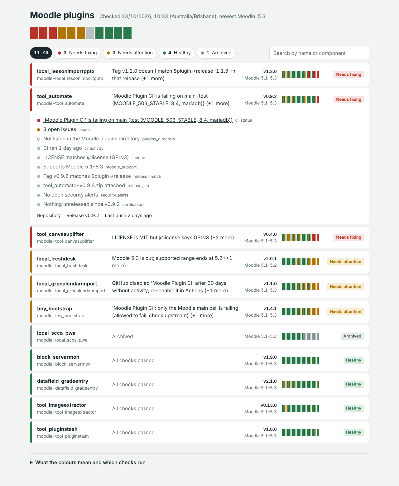

# Plugin Dashboard for YunoHost

A daily, colour-coded health dashboard for your Moodle plugin repositories, packaged as a YunoHost app.



## What it does

Once a day it finds every repository you own that contains a Moodle `version.php` and checks:

| Check | Red | Amber |
|---|---|---|
| CI status | CI failing on the default branch | Only the Moodle `main` cell failing; last run cancelled |
| Silent CI | | No CI, workflow disabled by GitHub, no run for 30+ days |
| Release matches version.php | Tag ≠ `$plugin->release` at that tag; version going backwards | No release yet |
| Release zip | No `.zip` on the latest release | Zip not named `<component>-<tag>.zip` |
| Unreleased changes | | Commits on the default branch since the latest tag |
| Issues | | Open issues or pull requests |
| New Moodle release watch | | Newest stable Moodle outside `$plugin->supported`, or missing from the CI matrix |
| Licence consistency | `LICENSE` file contradicts `@license` | README disagrees; missing LICENSE/README |
| Licence mode | In-house SCCA (Mode A) plugin in a public repo | |
| Security alerts | Critical/high Dependabot alerts | Medium/low alerts |
| Plugins directory | | moodle.org listing older than your latest release |

Plus: alerts by ntfy, email or Matrix when a colour changes; Prometheus metrics at `/metrics`; 30-day history per plugin; self-hosted GitLab support; your own checks as drop-in Python files.

## Install

```bash
sudo yunohost app install https://github.com/verzog/plugindash_ynh
```

Then follow the post-install note: add a read-only fine-grained GitHub token in the config panel and press **Run the check now**. See [doc/ADMIN.md](doc/ADMIN.md) for token permissions, Prometheus, and running it by hand.

## Development

The collector is plain Python 3.11+ with no third-party packages (`sources/plugindash/`). The page is static HTML/JS (`sources/www/`).

```bash
cd sources
python3 -m unittest discover -s tests           # Unit tests (no network).
python3 tests/make_preview.py /tmp/preview      # Sample-data preview in /tmp/preview/www.
cd /tmp/preview/www && python3 -m http.server   # Then open http://localhost:8000
```

Packaging uses YunoHost packaging v2 with helpers 2.1, for YunoHost 12 (Bookworm) and 13 (Trixie). Run `package_check` against it before publishing a new version.

## Licence

GPL-3.0-or-later. Copyright 2026 Vernon Spain.
